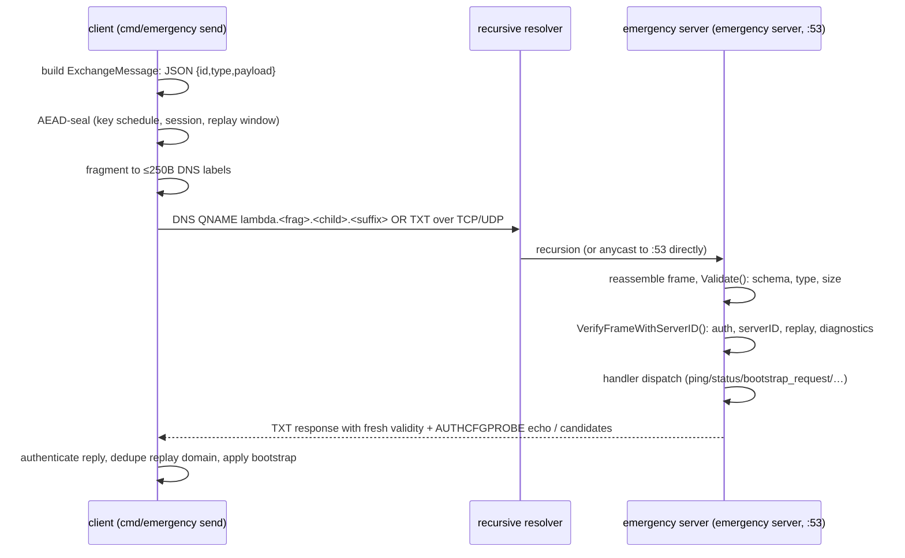

# Architecture

Reference tree (key implementation files):

```
cmd/main.go               cobra root
cmd/run/…                 YAML-driven client/server launch
cmd/emergency/…           emergency server/send/scan CLI + authorized-servers loader
internal/conf/            YAML parsing + validation (role, transports, endpoints)
internal/socket/           raw-packet capture (pcap) + injection
internal/tnet/kcp/         KCP transport with raw-TCP framing
internal/tnet/stream/      smux stream multiplexing, sealed/tls variants
internal/obfs/             length-randomizing obfuscation layer
internal/socks/  forward/  SOCKS5 client listeners, port forwarding
internal/client/  server/  both data-plane endpoints; identity-continuity tracking
internal/protocol/         baseline protocol helpers (upstream)
internal/ng/
  crypto/                  HKDF/AES-GCM key schedules (v2/v3/v4/v4.1), seeds, nonce bases
  protocol/                generic framing helpers
  replay/                  bounded replay window filter
  dns/                     resolver scanning
  transport/
    transport.go           transport abstraction touched by every strategy
    aead_stream.go         AEAD-sealed stream transport
    tls_outer.go           TLS-outer transport + candidate fingerprints
    sni_assisted.go        SNI-assisted transport variant
    asymmetric.go          v3/v4/v4.1 asymmetric sessions, authorized-server sets, replay-domain seams
    dns_asymmetric.go      DNS transport for asymmetric sessions
    dns_emergency.go       authoritative emergency DNS server + client Exchange
    recovery_state_machine.go  explicit recovery lifecycle
    selector.go            transport strategy selection
    asymmetric_spoof.go    connection-identity spoof-tolerant selection
    timeline_validator.go  candidate record validation (§validity windows)
```

## Data plane (inherited from upstream Paqet)

```mermaid
flowchart LR
    APP[local app] -->|SOCKS5/forward| IFSOCKS[internal/socks, forward]
    IFSOCKS --> SMUX[smux streams  internal/tnet/stream]
    SMUX --> KCP[KCP over raw TCP  internal/tnet/kcp]
    KCP --> OBFS[obfuscation  internal/obfs]
    OBFS --> RAWP[raw packet craft/capture  internal/socket]
    RAWP -->|pcap| NIC[NIC → server]
    NIC --> RAWP2[server: capture → parse]
    RAWP2 --> SMUX2[server: KCP+smux decode]
    SMUX2 -->|connect| DST[destination]
```



- Packets are crafted with spoofed-but-real IP/MAC headers and sent directly on the NIC; capture is pcap-filtered by port+flags. The kernel is not in the path, which is why firewall/RST rules matter ([TROUBLESHOOTING.md](TROUBLESHOOTING.md)).
- `aead_stream` / `tls_outer` / `sni_assisted` are alternate transports — selectable in config during probing/failover ([`transport.protocol`](CONFIGURATION.md#transport)).

## Control (emergency DNS) plane — Paqet-NGV2 additions



- `EmergencyMessage.Validate()` (**[transport/dns_emergency.go](…)**): schema-strict, unknown types rejected, payload ≤ `MaxEmergencyPayloadBytes`, opaque bytes (never executed or interpreted).
- Credential loading goes through the CLI loader ([`cmd/emergency/emergency.go`](…) `loadAuthorizedServersConfig`): deep-cloned secrets, strict JSON schema, several fail-closed file policies.
- Message-safety classes are explicit (`MessageTypeSafety`): read-only / idempotent / state-changing / unsupported.
- Restart behavior: in-memory sessions/reply caches are transient; safe-class handlers tolerate re-execution after restart (tested, see [TESTING.md](TESTING.md)).

## Recovery state machine

States (transport/recovery_state_machine.go):

```
PRIMARY_HEALTHY → PRIMARY_DEGRADED → EMERGENCY_SIGNALING → BOOTSTRAP_RECEIVED
                 → CANDIDATE_ENDPOINT_VALIDATING → RECOVERY_READY
                                             ↘ RECOVERY_FAILED → COOLDOWN → re-signal
```

- Telemetry: `StateTransitionEvent` records movements for audits.
- Connect the states to the selectors: `selector.go` (strategy choice), `asymmetric_spoof.go` (connection-identity continuity during redirection), `client/dial.go` (new-connection redirection by identity).

## Severed third-party trust notes

- Response credential = symmetric: both ends can authenticate-and-emit for that server identity ([SECURITY.md](SECURITY.md)).
- The lifetime replay-defense invariants only bind **within one credential epoch** (same PSK/server secret); rotation resets the domain.
